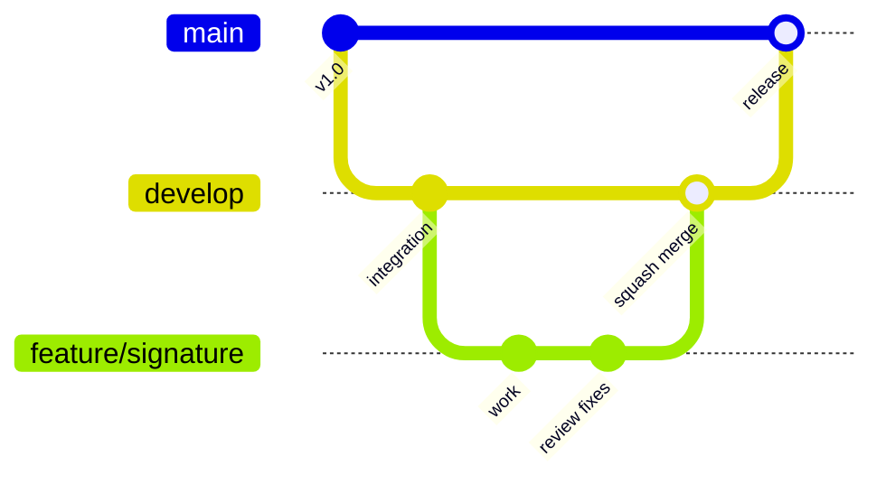

# Contributing to Nimzo

## First-time setup

1. Clone the repository and follow **Instalación y configuración** in the [README](README.md).
2. Enable the shared Git hooks (once per clone):

   ```bash
   git config core.hooksPath .githooks
   ```

   - `pre-push` blocks direct pushes to `main` and `develop`.
   - `commit-msg` rejects messages that don't follow Conventional Commits.

## Branches



| Branch | Created from | Merges into | Who merges |
|---|---|---|---|
| `main` | — | — | Production. Only receives releases from `develop`. |
| `develop` | `main` | `main` (release PR) | Software lead |
| `feature/<name>` | `develop` | `develop` | Software lead, after review |
| `fix/<name>` | `develop` | `develop` | Software lead, after review |
| `fix/<name>` (urgent production fix) | `main` | `main`, then `main` is merged back into `develop` | Software lead |

Rules:

- Never push to `main` or `develop`. Every change goes through a pull request.
- Keep branches short-lived and PRs small (under ~400 changed lines when possible).
- Before opening a PR, update your branch with the latest `develop`:

  ```bash
  git fetch origin
  git rebase origin/develop
  ```

## Commits

Follow [Conventional Commits](https://www.conventionalcommits.org/), with an optional scope for the area:

```
feat(mobile): add supervisor signature capture
fix(admin): correct branch address autofill
docs(forms): document F-SER-014
refactor(shared): simplify the form engine
chore: update dependencies
```

Types: `feat`, `fix`, `docs`, `style`, `refactor`, `perf`, `test`, `build`, `ci`, `chore`, `revert`.

## Pull requests

1. Push your branch and open a PR against **`develop`** (not `main`).
2. Fill in the PR template.
3. Request review from **@Paytini** in the *Reviewers* field. This has to be done by hand: GitHub's free plan does not auto-assign code owners on private repos.
4. Wait for CI (lint and typecheck) to pass, then address review comments with new commits.
5. The software lead merges:
   - `feature/*` and `fix/*` → `develop`: **Squash and merge** (one commit per PR).
   - `develop` → `main`: **Create a merge commit**. Squashing here would make `develop` and `main` diverge.

## Guardrails on the free plan

GitHub cannot enforce branch protection on this private repository, so the rules are enforced in layers:

| Layer | What it does |
|---|---|
| `.githooks/` | Blocks pushes to `main`/`develop` and malformed commit messages on your machine |
| `.claude/settings.json` | Prevents Claude Code from pushing to `main`/`develop`, force-pushing or merging PRs |
| `.github/workflows/protected-branches.yml` | Opens an issue assigned to the software lead if a commit reaches `main`/`develop` without a merged PR |
| `.github/workflows/ci.yml` | Runs lint and typecheck on every PR |

The hooks can be skipped with `--no-verify`. Don't do that for protected branches. They exist to prevent mistakes, and the workflow will flag the push anyway.
