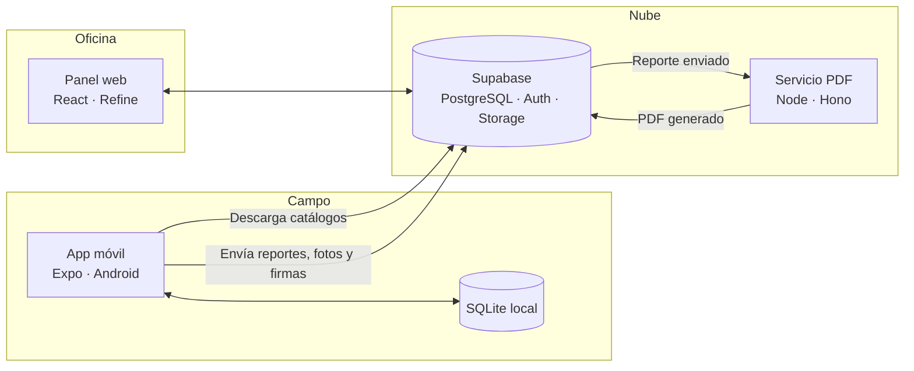
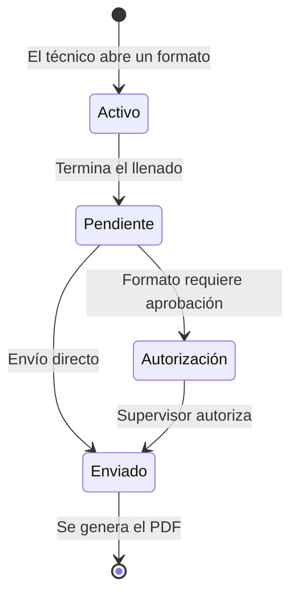

<div align="center">

# Nimzo

**Plataforma de inspección, prueba y mantenimiento de sistemas contra incendio**

Digitaliza los formatos de servicio en campo, trabaja sin conexión y genera reportes profesionales para cada cliente.


</div>

---

## Tabla de contenidos

- [Descripción general](#descripción-general)
- [Características principales](#características-principales)
- [Arquitectura](#arquitectura)
- [Ciclo de vida de un reporte](#ciclo-de-vida-de-un-reporte)
- [Stack tecnológico](#stack-tecnológico)
- [Estructura del repositorio](#estructura-del-repositorio)
- [Requisitos previos](#requisitos-previos)
- [Instalación y configuración](#instalación-y-configuración)
- [Variables de entorno](#variables-de-entorno)
- [Scripts disponibles](#scripts-disponibles)
- [Flujo de trabajo con Git](#flujo-de-trabajo-con-git)
- [Despliegue](#despliegue)
- [Seguridad](#seguridad)
- [Hoja de ruta](#hoja-de-ruta)
- [Licencia](#licencia)

---

## Descripción general

**Nimzo** es una solución para empresas de protección contra incendios que realizan servicios de inspección, prueba y mantenimiento (IPM) en instalaciones industriales.

El personal técnico llena los **formatos de servicio** directamente en una tablet, incluso sin conexión a internet, capturando checklists, mediciones, fotografías y firmas. Al enviar un reporte, la plataforma lo almacena de forma segura y genera un documento PDF listo para entregarse al cliente.

> [!IMPORTANT]
> La app móvil está pensada **exclusivamente para tablets Android**. iOS (iPhone y iPad) no está soportado: la app no se compila, publica ni prueba para iOS, y las decisiones de diseño y de librerías se toman pensando solo en Android.

> [!NOTE]
> El sistema está compuesto por tres piezas que comparten un mismo backend: una **app móvil** para técnicos, un **panel web** para administradores y un **servicio de generación de PDF**.

### Usuarios del sistema

| Rol | Plataforma | Responsabilidades |
|---|---|---|
| **Técnico** | App móvil | Llena, firma y envía formatos de servicio en campo. |
| **Supervisor** | App móvil | Firma reportes y autoriza los formatos que lo requieren. |
| **Administrador** | Panel web | Gestiona usuarios, clientes, sucursales, sistemas y paquetes de servicio. |

---

## Características principales

### App móvil (técnicos)

- **Catálogo de formatos** de servicio identificados por código (`F-SER-XXX`).
- **Paquetes de servicio** por sucursal y frecuencia (semanal, mensual, trimestral, anual) que generan todos los formatos de una visita en un solo paso.
- **Motor de formatos dinámico**: checklists `N/A / X / OK`, preguntas `SI / NO`, campos de texto, fecha y hora, listas desplegables y grupos repetibles.
- **Evidencia fotográfica** con descripción, comprimida automáticamente antes de subirse.
- **Firmas digitales** de técnico y supervisor, con firma guardada en el perfil del técnico.
- **Funcionamiento sin conexión**: los borradores y reportes terminados se guardan en el dispositivo hasta que el técnico decide enviarlos.
- **Diseño optimizado para tablets Android**, en orientación horizontal y vertical.

### Panel web (administradores)

- Alta y gestión de **usuarios y roles**.
- Gestión de **clientes, sucursales y sistemas** contra incendio.
- Configuración de **paquetes de servicio** por sucursal.
- Consulta del **historial de reportes** y descarga de PDF.

### Servicio de reportes

- Generación del **PDF en el servidor** al momento de enviar el reporte, con formato homogéneo e identidad de la empresa.

---

## Arquitectura



### Principios de diseño

1. **Formatos como datos.** Cada formato se define en JSON, validado con Zod, dentro de `packages/shared`. Un único motor los presenta en la app y los utiliza para el PDF. Agregar o modificar un formato no requiere programar pantallas nuevas.
2. **Offline primero.** La app opera sobre una base de datos local. La sincronización consiste en dos flujos simples: descarga de catálogos y subida de reportes enviados.
3. **Código compartido.** Tipos, esquemas y definiciones de formatos viven en un solo paquete que consumen la app, el panel web y el servicio de PDF.

> [!TIP]
> Para agregar un formato nuevo basta con crear su definición JSON en `packages/shared/formatos/` y registrarlo. El motor se encarga del resto.

---

## Ciclo de vida de un reporte



| Estado | Ubicación | Descripción |
|---|---|---|
| **Activo** | Dispositivo | Borrador en proceso de llenado. |
| **Pendiente** | Dispositivo | Reporte terminado, listo para enviarse. |
| **Autorización** | Nube | En espera de aprobación del supervisor. |
| **Enviado** | Nube | Reporte registrado y PDF generado. |

---

## Stack tecnológico

| Capa | Tecnología |
|---|---|
| Lenguaje | TypeScript |
| Monorepo | pnpm workspaces · Turborepo |
| App móvil | React Native · Expo · Expo Router |
| Persistencia local | expo-sqlite · Drizzle ORM |
| Formularios | React Hook Form · Zod |
| Estilos móviles | NativeWind |
| Multimedia | expo-image-picker · expo-image-manipulator · react-native-signature-canvas |
| Panel web | React · Vite · Refine |
| Interfaz web | Material UI (vía Refine) |
| Backend | Supabase (PostgreSQL · Auth · Storage · RLS) |
| Generación de PDF | Node.js · Hono · @react-pdf/renderer |
| Compilación móvil | EAS Build · EAS Update |
| Calidad | ESLint · Prettier · GitHub Actions · Sentry |

---

## Estructura del repositorio

```
nimzo/
├── apps/
│   ├── mobile/          # App móvil para técnicos (Expo · Android)
│   └── admin/           # Panel web para administradores
├── packages/
│   └── shared/          # Tipos, esquemas Zod y definiciones de formatos
├── services/            # (Más adelante) Servicio de generación de reportes PDF
├── supabase/            # Migraciones, políticas RLS y datos de prueba
├── docs/                # Documentación técnica y de formatos
├── .github/             # Flujos de CI y plantillas de PR
├── CLAUDE.md            # Contexto del proyecto para asistentes de código
└── README.md
```

---

## Requisitos previos

| Herramienta | Versión recomendada | Uso |
|---|---|---|
| [Node.js](https://nodejs.org/) | 22 LTS (ver `.nvmrc`) | Entorno de ejecución |
| [pnpm](https://pnpm.io/) | La fijada en `package.json` (`corepack enable pnpm`) | Gestor de paquetes |
| [Supabase CLI](https://supabase.com/docs/guides/cli) | Incluida en el proyecto (`pnpm supabase`) | Migraciones |
| Acceso al proyecto de Supabase | — | Invitación del líder de software a la organización en Supabase |
| [EAS CLI](https://docs.expo.dev/build/setup/) | Última estable | Compilación de la app |
| Android Studio (emulador de tablet) o tablet Android | Android 10+ | Pruebas de la app |

---

## Instalación y configuración

**1. Clonar el repositorio**

```bash
git clone https://github.com/PETROV2026/nimzo-app.git
cd nimzo-app
```

**2. Instalar dependencias**

```bash
pnpm install
```

**3. Vincular el proyecto de Supabase**

```bash
pnpm supabase login
pnpm supabase link --project-ref <project-ref>   # Pide la contraseña de la base de datos
```

**4. Configurar variables de entorno**

```bash
pnpm env:setup
```

Crea `apps/mobile/.env` y `apps/admin/.env` con la URL y la clave pública del proyecto vinculado.

**5. Iniciar el entorno de desarrollo**

```bash
pnpm dev
```

> [!IMPORTANT]
> Por ahora hay **un solo proyecto de Supabase en la nube**, compartido por desarrollo y producción. Mientras no haya clientes reales es aceptable, pero antes del lanzamiento se debe crear un proyecto separado para desarrollo. Las migraciones las aplica únicamente el líder de software con `pnpm supabase db push`, después de revisar el PR.

---

## Variables de entorno

| Variable | Ubicación | Descripción |
|---|---|---|
| `EXPO_PUBLIC_SUPABASE_URL` | `apps/mobile` | URL del proyecto de Supabase |
| `EXPO_PUBLIC_SUPABASE_ANON_KEY` | `apps/mobile` | Clave pública de Supabase |
| `VITE_SUPABASE_URL` | `apps/admin` | URL del proyecto de Supabase |
| `VITE_SUPABASE_ANON_KEY` | `apps/admin` | Clave pública de Supabase |

> [!CAUTION]
> La clave `service_role` de Supabase omite todas las políticas de seguridad. **Nunca** debe incluirse en la app móvil, en el panel web ni en el repositorio. Solo la usará el servicio de PDF, que se desarrollará más adelante.

---

## Scripts disponibles

Ejecutar desde la raíz del repositorio:

| Comando | Descripción |
|---|---|
| `pnpm dev` | Inicia todos los proyectos en modo desarrollo |
| `pnpm dev --filter mobile` | Inicia solo la app móvil |
| `pnpm dev --filter admin` | Inicia solo el panel web |
| `pnpm build` | Compila todos los proyectos |
| `pnpm lint` | Revisa el código con ESLint |
| `pnpm format` | Formatea el código con Prettier |
| `pnpm typecheck` | Verifica los tipos de TypeScript |

---

## Flujo de trabajo con Git

### Ramas

| Rama | Propósito |
|---|---|
| `main` | Versión estable en producción. Protegida: solo recibe cambios vía Pull Request. |
| `develop` | Integración de funcionalidades terminadas. |
| `feature/<nombre>` | Desarrollo de una funcionalidad específica. |
| `fix/<nombre>` | Corrección de errores. |

### Convención de commits

Se sigue el estándar [Conventional Commits](https://www.conventionalcommits.org/es/):

```
feat: agrega captura de firma del supervisor
fix: corrige autollenado de dirección de sucursal
docs: documenta formato F-SER-014
refactor: simplifica el motor de formatos
chore: actualiza dependencias
```

---

## Despliegue

| Componente | Destino | Método |
|---|---|---|
| App móvil | Google Play (prueba interna) | `eas build --platform android` y `eas submit` |
| Actualizaciones menores de la app | Dispositivos instalados | `eas update` |
| Panel web | Hosting estático | Compilación con Vite |
| Servicio PDF | Railway o Render | Despliegue continuo desde `main` |
| Base de datos | Supabase | `supabase db push` con migraciones versionadas |

> [!WARNING]
> Los cambios a la base de datos de producción se aplican **únicamente** mediante migraciones versionadas en `supabase/`. No se realizan cambios manuales desde el panel de Supabase.

---

## Seguridad

- **Registro público desactivado.** Las cuentas las crean exclusivamente los administradores.
- **Row Level Security (RLS)** activo en todas las tablas: cada usuario accede únicamente a la información que le corresponde según su rol.
- **Almacenamiento privado** para fotografías y firmas, con acceso mediante URLs firmadas temporales.
- **Sin datos reales** en el repositorio ni en entornos de desarrollo; se utilizan datos de prueba.
- **Secretos fuera del código**: archivos `.env`, llaves de firma y credenciales están excluidos en `.gitignore`.

---

## Hoja de ruta

- [ ] Estructura base del monorepo
- [ ] Esquema de base de datos y políticas RLS
- [ ] Autenticación y perfiles de usuario
- [ ] Panel web: usuarios, clientes, sucursales, sistemas y paquetes
- [ ] Motor de formatos dinámico
- [ ] Flujo de reportes: Activo → Pendiente → Autorización → Enviado
- [ ] Fotografías y firmas digitales
- [ ] Generación de PDF
- [ ] MVP con los primeros 5 formatos
- [ ] Captura del catálogo completo de formatos
- [ ] Pruebas en campo y publicación

---

## Licencia

**Software propietario.** © PETROV. Todos los derechos reservados.

Queda prohibida la copia, distribución o modificación de este software sin autorización expresa y por escrito de [Nombre de la empresa].